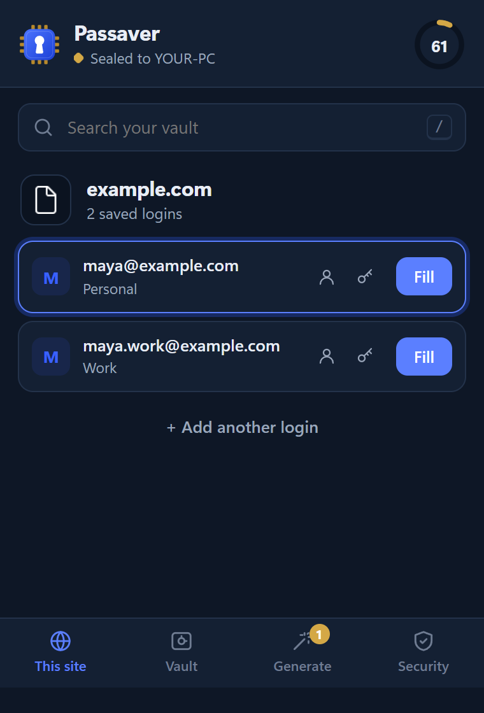
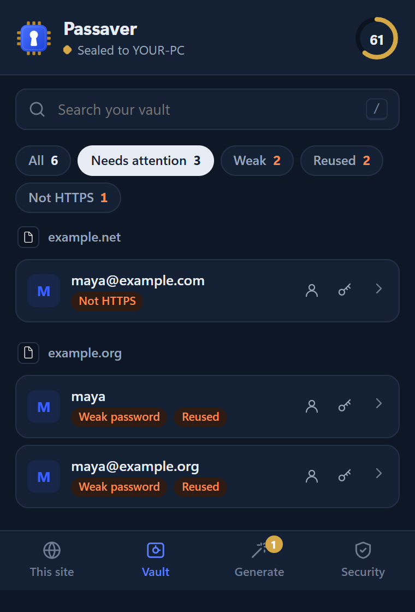
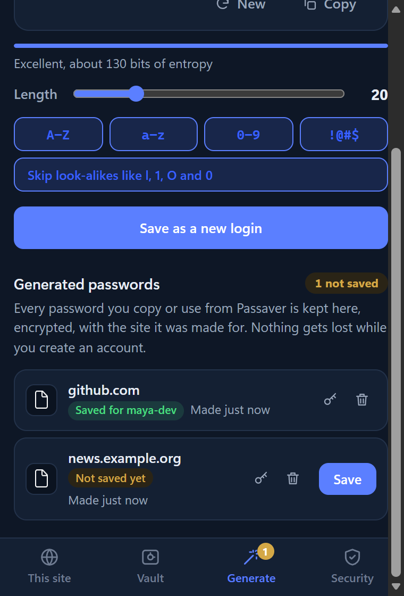
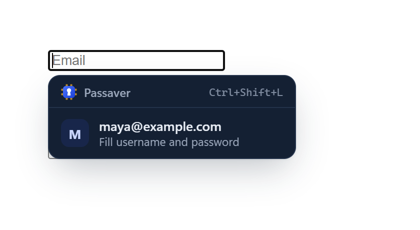
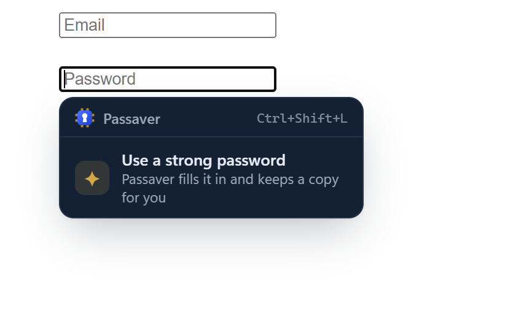
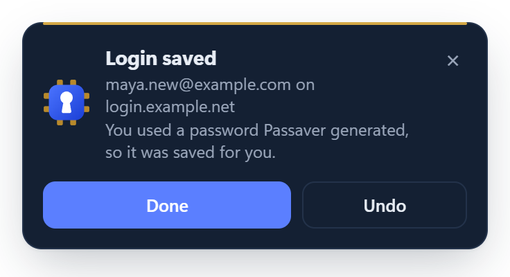

<p align="center">
  
</p>

<h1 align="center">Passaver</h1>

<p align="center">
  A password saver for Chrome, Edge and Brave on Windows. It is <b>sealed to your computer</b>:<br>
  a copied vault is useless on any other machine.
</p>

<p align="center">
  
  
  
</p>

## Why Passaver

Most password managers sync your vault to a cloud account. Passaver does the opposite. The vault never leaves your PC, and it can only be decrypted on that PC, by your Windows account. Nobody can open it after copying it: not someone who steals the file, not a backup leak, and not malware that uploads it somewhere.

You still get the convenience. Logins are saved as you sign in and filled with one click. They survive clearing your browser data, and every Chromium browser on the PC shares them.

## Features

- **One-click sign-in.**
  - Click a login field and pick your account.
  - Or press `Ctrl+Shift+L`.
  - Or open the popup and press `Enter`.
- **Saves as you sign in.**
  - Detects new and changed passwords.
  - Handles two-step logins (email first, password next) and sign-up and change-password forms.
- **Generated passwords are never lost.**
  - Sign-up fields offer **Use a strong password**.
  - Every generated password is kept in an encrypted history with its site.
  - An account created with one is saved automatically, with an Undo option.
- **Vault health.** A 0–100 score in the header. One click lists weak, reused, non-HTTPS and over-a-year-old passwords. The editor warns while you type when a password is already used on another site.
- **Optional PIN.**
  - The vault then needs the PIN as well as the computer.
  - Auto-lock after a time you choose, and when Windows locks.
  - Brute-force delays on wrong PINs.
- **Built to resist phishing.**
  - Logins match by registrable domain.
  - HTTPS logins are never filled into HTTP pages.
  - A frame only receives a password after its own origin is checked.
- **Private by design.** No account, no cloud, no telemetry, and no network requests at all.

<p align="center">
  
  
  
</p>

## How the device seal works

```
 Browser extension                          Passaver host (this PC, this Windows user)
 ─────────────────                          ──────────────────────────────────────────
 AES-256-GCM encrypt / decrypt   ◄── key ── device.key = DPAPI(user) ∘ DPAPI(machine)
 of the whole vault (in memory)               entropy: SHA-256(machine GUID ‖ user SID)
                                 ── blob ─► vault.bin  = ciphertext only
```

1. On first use, a random 256-bit key is created. Windows DPAPI wraps it twice: first to this machine, then to this Windows user.
2. The extension encrypts the whole vault with AES-256-GCM: websites, usernames, passwords and history.
3. A small native helper keeps the files in `%LOCALAPPDATA%\Passaver\data`, outside the browser profile. Clearing browser data does not erase them.
4. On another computer or another Windows account, DPAPI refuses to unwrap the key. Passaver then shows *"This vault belongs to another device"* and never overwrites it.

With a PIN, the vault key becomes `HKDF(device key ‖ PBKDF2-SHA256(PIN, 600,000 rounds))`. The full threat model, including what Passaver does **not** protect against, is in [SECURITY.md](SECURITY.md).

> **Important:** reinstalling Windows, resetting the PC or forgetting your PIN makes the vault unreadable for good. That follows from the device seal. Keep recovery options (such as each site's own account recovery) for the accounts that matter most.

## Install

You need Windows 10 or 11 and Chrome, Edge, Brave or Chromium.

1. **Download** `passaver-extension-vX.Y.Z.zip` and `passaver-host-vX.Y.Z.zip` from [Releases](../../releases), and unzip both.
2. **Load the extension.**
   - Open `chrome://extensions` (or `edge://extensions`) and turn on **Developer mode**.
   - Click **Load unpacked** and choose the unzipped extension folder.
   - Its ID is always `ipgoiopgjfjbkmakfonhapkfagdmdipm`.
3. **Install the helper.** In the host folder, right-click `install.ps1` and choose **Run with PowerShell**. It installs for your Windows user only and needs no admin rights.
4. **Restart the browser.** The popup now shows **Sealed to** followed by your computer's name.

To build from source instead, clone the repository, load the `extension` folder, and run:

```bash
powershell -ExecutionPolicy Bypass -File host\install.ps1
```

## Uninstall

```bash
powershell -ExecutionPolicy Bypass -File host\uninstall.ps1
```

Then remove the extension from the browser. Your encrypted vault is kept unless you add `-DeleteVault`.

## Development

There are no dependencies; Node.js 22 or later is enough.

| Command | What it does |
| --- | --- |
| `npm test` | Crypto, domain matching, generator and native host tests |
| `npm run test:e2e` | The full extension in a throwaway Edge profile with a temporary vault |
| `npm run scan` | Privacy scan: blocks user paths, computer names, real e-mails, keys and vault files |
| `npm run pack` | Release zips and checksums in `dist/`, after the privacy scan passes |
| `npm run screenshots` | Regenerates `docs/screenshots/` from demo data with the computer name `YOUR-PC` |
| `npm run hooks` | Runs the privacy scan before every commit |

```
extension/   Manifest V3 extension: background.js, content.js, popup.*, lib/
host/        native host (DPAPI key sealing + vault storage), install / uninstall
test/        unit, host and end-to-end tests, plus the Edge test harness
tools/       privacy scan, packaging, icon and screenshot rendering
```

See [CONTRIBUTING.md](CONTRIBUTING.md) for the release process.

## License

[MIT](LICENSE)
