<p align="center">
  <picture>
    <source media="(prefers-color-scheme: dark)" srcset="docs/banner-dark.png">
    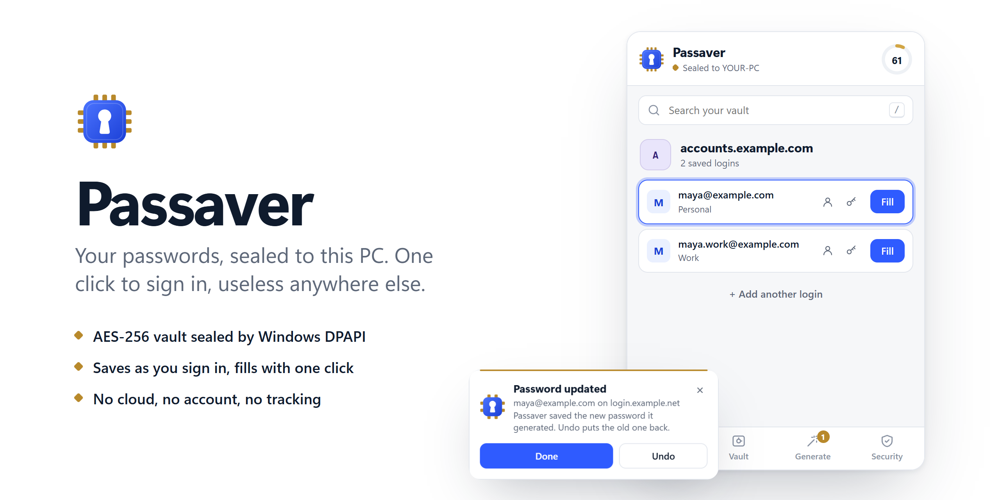
  </picture>
</p>

<p align="center">
  <a href="https://github.com/LeerBox/Passaver/actions/workflows/ci.yml"></a>
  <a href="https://github.com/LeerBox/Passaver/releases/latest"></a>
  
  
  <a href="LICENSE"></a>
</p>

<p align="center">
  <a href="https://github.com/LeerBox/Passaver/releases/latest"><b>Download</b></a>&nbsp;&nbsp;&nbsp;
  <a href="#install-in-two-minutes"><b>Install</b></a>&nbsp;&nbsp;&nbsp;
  <a href="#how-the-seal-works"><b>How it works</b></a>&nbsp;&nbsp;&nbsp;
  <a href="SECURITY.md"><b>Security</b></a>
</p>

Passaver is a password manager for Chrome, Edge and Brave on Windows. Your vault stays on your PC and nowhere else. Windows seals the vault's key to this machine and your Windows account, so a copy of the files can't be opened on any other computer, not even by you.

It saves logins as you sign in, fills them with one click, and tells you which passwords to replace. Then it helps you replace them.

## What it does

### Signs you in with one click

Click a login field and pick the account. You can also press `Ctrl+Shift+L` on the page, or open Passaver and press `Enter`.

A login fills itself only on the exact site where you saved it. Logins from sibling subdomains are listed with their address, so choosing one is always deliberate.

<p align="center">
  <picture>
    <source media="(prefers-color-scheme: dark)" srcset="docs/screenshots/dark/popup-site.png">
    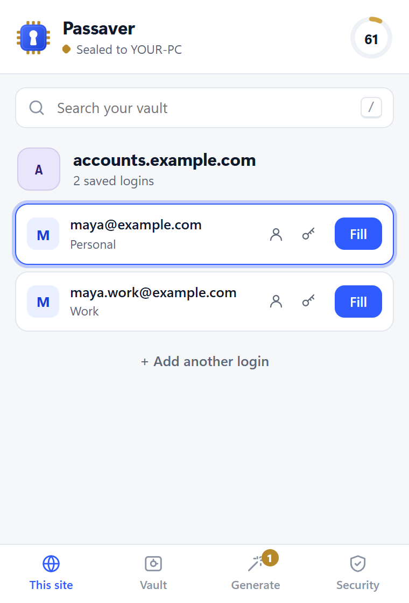
  </picture>
  &nbsp;
  <picture>
    <source media="(prefers-color-scheme: dark)" srcset="docs/screenshots/dark/page-fill.png">
    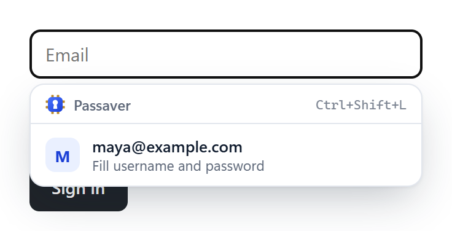
  </picture>
</p>

### Saves as you go, and never loses a generated password

Passaver notices when you sign in, sign up or change a password, and offers to save or update the login.

On sign-up forms it offers a strong password and fills both password fields. It also keeps an encrypted copy before you even submit the form. If you create the account with that password, the login is saved for you automatically, with an Undo button.

<p align="center">
  <picture>
    <source media="(prefers-color-scheme: dark)" srcset="docs/screenshots/dark/page-suggest.png">
    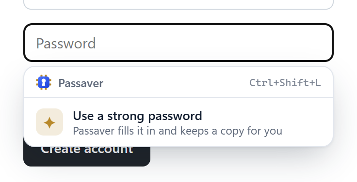
  </picture>
  &nbsp;
  <picture>
    <source media="(prefers-color-scheme: dark)" srcset="docs/screenshots/dark/page-autosaved.png">
    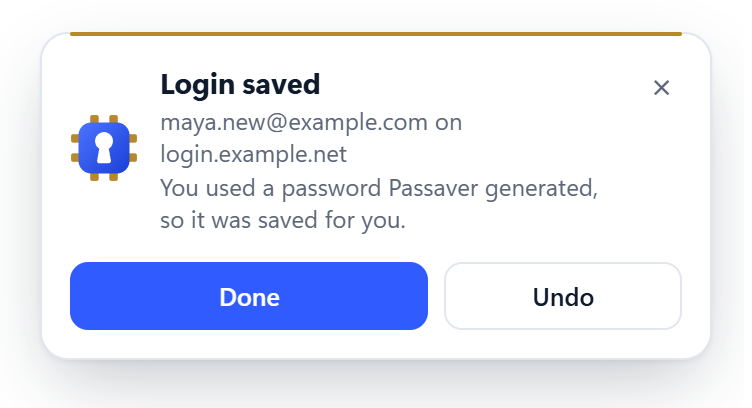
  </picture>
</p>

<p align="center">
  <picture>
    <source media="(prefers-color-scheme: dark)" srcset="docs/screenshots/dark/popup-generate.png">
    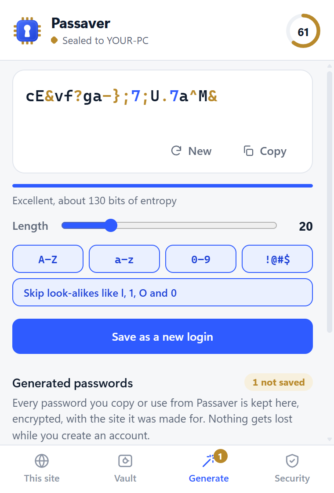
  </picture>
  &nbsp;
  <picture>
    <source media="(prefers-color-scheme: dark)" srcset="docs/screenshots/dark/popup-history.png">
    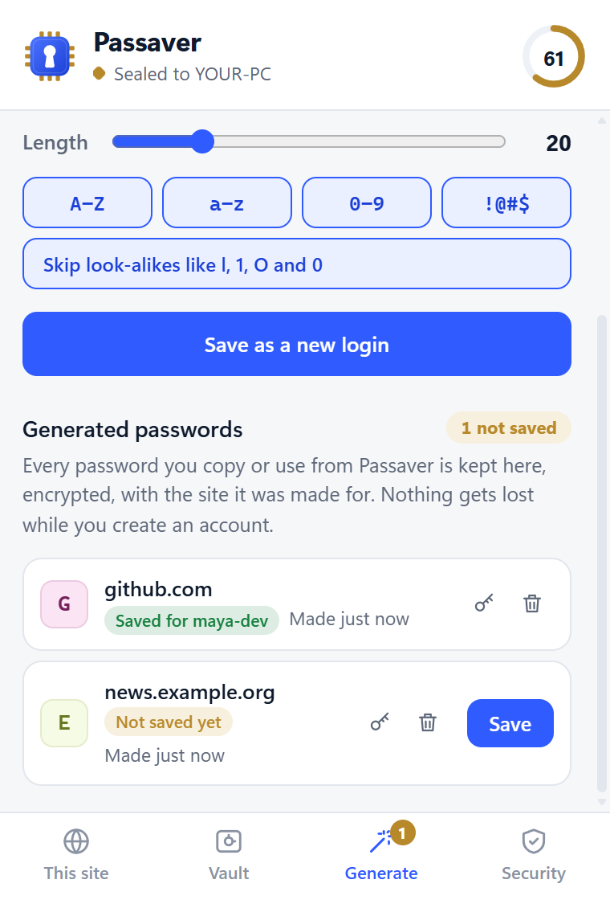
  </picture>
</p>

### Shows you what to fix, and helps you fix it

The ring in the header scores your vault from 0 to 100. Passaver flags these problems, worst first:

- weak passwords
- reused passwords
- passwords over a year old
- logins saved on pages without HTTPS

**Fix** opens the site's own change-password page, using the standard [`/.well-known/change-password`](https://w3c.github.io/webappsec-change-password-url/) address. Passaver offers a strong password there and updates the saved login when you save the change. Undo puts the old password back.

<p align="center">
  <picture>
    <source media="(prefers-color-scheme: dark)" srcset="docs/screenshots/dark/popup-vault.png">
    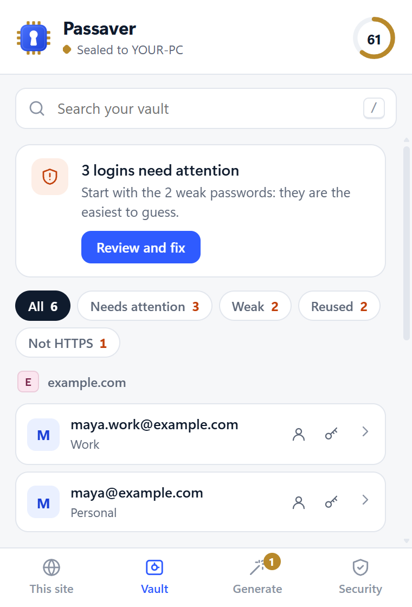
  </picture>
  &nbsp;
  <picture>
    <source media="(prefers-color-scheme: dark)" srcset="docs/screenshots/dark/popup-attention.png">
    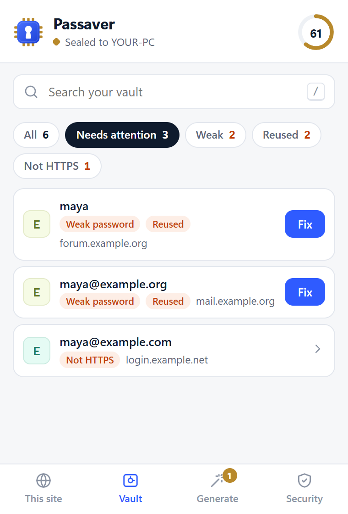
  </picture>
  &nbsp;
  <picture>
    <source media="(prefers-color-scheme: dark)" srcset="docs/screenshots/dark/popup-editor-fix.png">
    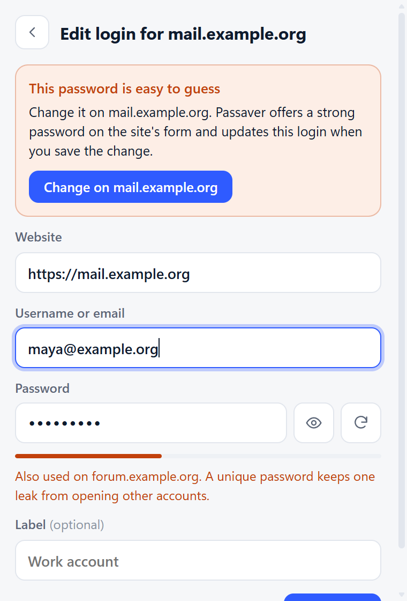
  </picture>
</p>

<p align="center">
  <picture>
    <source media="(prefers-color-scheme: dark)" srcset="docs/diagrams/dark/fix-flow.png">
    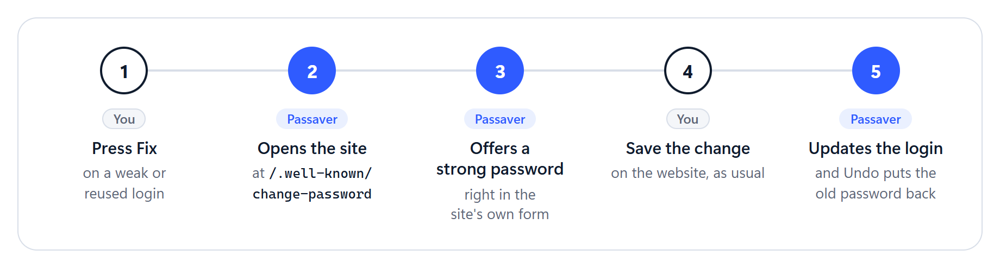
  </picture>
</p>

<p align="center">
  <picture>
    <source media="(prefers-color-scheme: dark)" srcset="docs/screenshots/dark/page-change.png">
    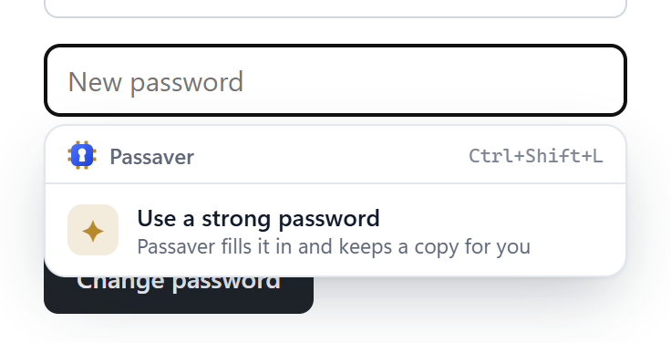
  </picture>
  &nbsp;
  <picture>
    <source media="(prefers-color-scheme: dark)" srcset="docs/screenshots/dark/page-updated.png">
    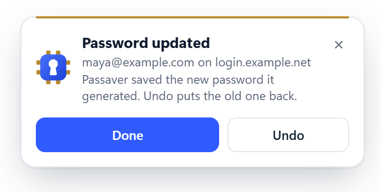
  </picture>
</p>

### Locks with a PIN when you want more

Add a PIN and the vault needs both this PC and the PIN to open. Passaver locks itself after a period of inactivity that you choose, and whenever Windows locks. Each wrong PIN adds a growing delay.

<p align="center">
  <picture>
    <source media="(prefers-color-scheme: dark)" srcset="docs/screenshots/dark/popup-locked.png">
    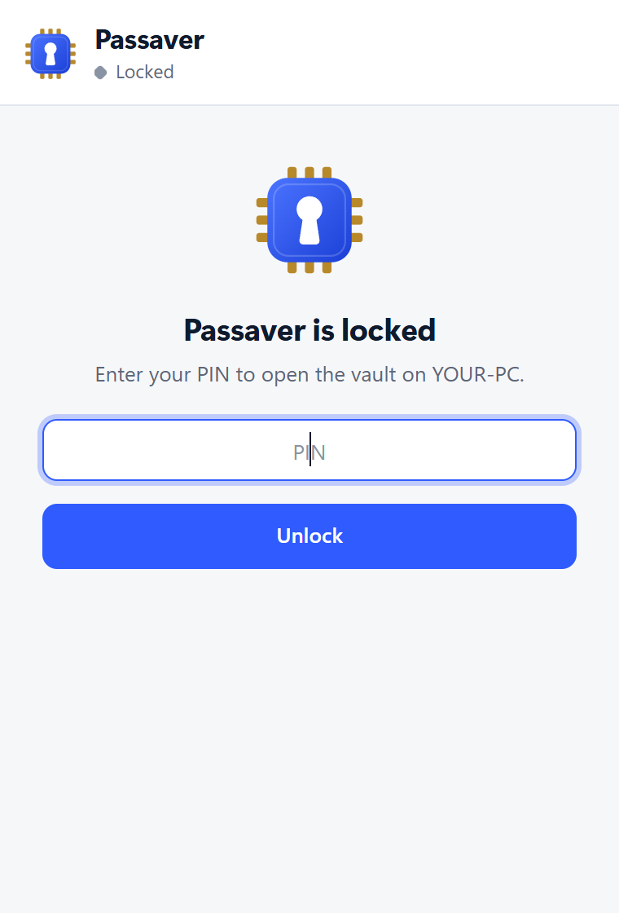
  </picture>
  &nbsp;
  <picture>
    <source media="(prefers-color-scheme: dark)" srcset="docs/screenshots/dark/popup-security.png">
    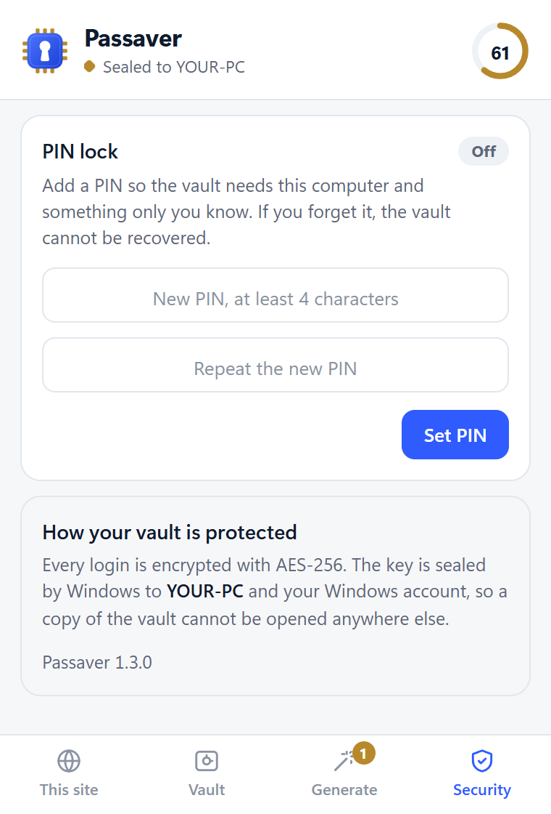
  </picture>
</p>

## How the seal works

<p align="center">
  <picture>
    <source media="(prefers-color-scheme: dark)" srcset="docs/diagrams/dark/seal.png">
    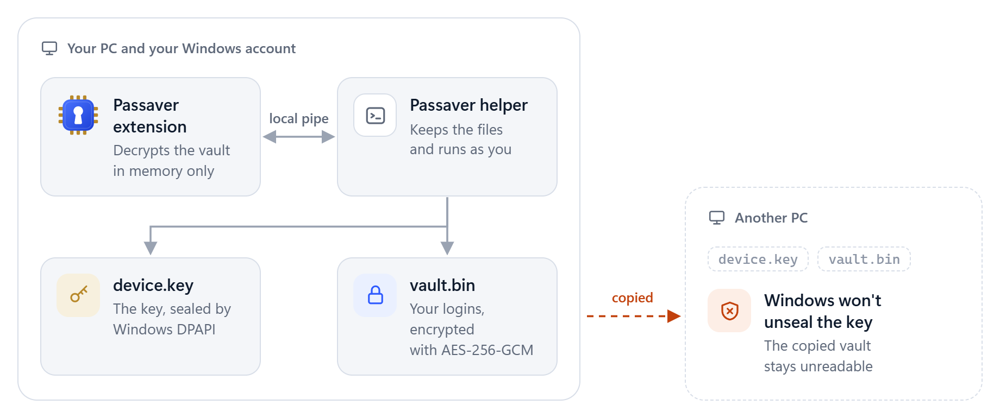
  </picture>
</p>

1. **On first use, a random 256-bit key is created.** Windows DPAPI seals it twice, first to this machine and then to your Windows account. A fingerprint of the machine and the account is mixed in.
2. **The extension encrypts the whole vault with AES-256-GCM.** That covers websites, usernames, passwords and generated-password history. The decrypted copy exists only in the extension's memory.
3. **A small helper stores the encrypted files** in `%LOCALAPPDATA%\Passaver\data`, outside the browser. Clearing browser data doesn't erase them, and every Chromium browser on the PC shares the same vault.
4. **Elsewhere, Windows refuses to unseal the key.** On another computer or another Windows account, Passaver says *This vault belongs to another device* and never overwrites it.

With a PIN, the vault key becomes `HKDF(device key ‖ PBKDF2-SHA256(PIN, 600,000 rounds))`. [SECURITY.md](SECURITY.md) has the full threat model, including what Passaver does **not** protect against.

Passaver has no servers, no account and no telemetry. The extension never sends your data anywhere. The only page it opens on its own is a site's change-password page, and only when you press Fix.

## Is Passaver right for you?

| A great fit if you… | Look elsewhere if you need… |
| --- | --- |
| Sign in to your accounts from one Windows PC | Your passwords on a phone, a Mac or a second PC |
| Don't want a cloud account holding your passwords | To share logins with family or a team |
| Like software small enough to read in an afternoon | A way back in if the PC is lost or Windows is reinstalled |

## Install in two minutes

You need Windows 10 or 11 and Chrome, Edge, Brave or Chromium.

1. **Download** `passaver-extension-vX.Y.Z.zip` and `passaver-host-vX.Y.Z.zip` from the [latest release](https://github.com/LeerBox/Passaver/releases/latest), and unzip both.
2. **Load the extension.**
   - Open `chrome://extensions` (or `edge://extensions`) and turn on **Developer mode**.
   - Click **Load unpacked** and choose the unzipped extension folder.
   - Its ID is always `ipgoiopgjfjbkmakfonhapkfagdmdipm`.
3. **Install the helper.** In the host folder, right-click `install.ps1` and choose **Run with PowerShell**. It installs for your Windows user only and needs no admin rights.
4. **Restart the browser.** Open Passaver: it should say **Sealed to** followed by your PC's name.

<details>
<summary><b>Check the download, update, or uninstall</b></summary>

**Check the download.** Compare each zip's hash with `SHA256SUMS.txt` from the same release:

```powershell
Get-FileHash .\passaver-extension-vX.Y.Z.zip -Algorithm SHA256
```

**Update.** Unzip the new extension over the old folder, then press **reload** on Passaver in the extensions page. Your vault isn't touched.

**Uninstall.** Run the following, then remove the extension from the browser. Your encrypted vault is kept unless you add `-DeleteVault`.

```powershell
powershell -ExecutionPolicy Bypass -File host\uninstall.ps1
```

</details>

<details>
<summary><b>Install from source</b></summary>

Clone the repository, load the `extension` folder with **Load unpacked**, and register the helper:

```powershell
powershell -ExecutionPolicy Bypass -File host\install.ps1
```

</details>

## Keyboard

| Where | Key | What it does |
| --- | --- | --- |
| Any page | `Ctrl+Shift+L` | Fills the best login saved for this exact site |
| Passaver | `Enter` | Fills the selected login |
| Passaver | `↑` `↓` | Moves through the list |
| Passaver | `/` | Searches the vault |
| Passaver | `Esc` | Clears the search or closes the editor |

## Questions

<details>
<summary><b>What happens if I reinstall Windows or move to a new PC?</b></summary>

The vault can't be opened there. That is the point of the seal: the key only unseals on the Windows installation and account that created it. Passaver can't export passwords yet. Before you reinstall, make sure you can recover your important accounts through the sites themselves.

</details>

<details>
<summary><b>Can I use Passaver on two computers?</b></summary>

Each PC has its own vault, and they don't sync. That is deliberate: no copy of your vault ever leaves the machine.

</details>

<details>
<summary><b>Does it work in Firefox, or on a Mac?</b></summary>

Not today. Passaver relies on Windows DPAPI and Chromium's native messaging. It needs Windows and Chrome, Edge, Brave or Chromium.

</details>

<details>
<summary><b>Why does it ask to "read and change all your data on all websites"?</b></summary>

To fill and save logins anywhere, Passaver has to find login forms and notice sign-in buttons on the pages you visit. Nothing it reads leaves your PC, and it has nowhere to send it.

</details>

<details>
<summary><b>Where are my passwords stored, and can I back them up?</b></summary>

They are in `%LOCALAPPDATA%\Passaver\data`:

- `device.key`: the sealed key
- `vault.bin`: the encrypted vault
- `vault.bak`: the previous version

A copy of this folder protects you against accidental deletion or a failing disk on the same Windows installation. It can't be restored on another PC, or after Windows is reinstalled.

</details>

<details>
<summary><b>I forgot my PIN.</b></summary>

There's no recovery, because the PIN is part of the key. To start over with an empty vault, run `host\uninstall.ps1 -DeleteVault`, then install again.

</details>

<details>
<summary><b>Has the code been audited?</b></summary>

Not by a third party. The codebase is small, and [SECURITY.md](SECURITY.md) explains the design and its limits. Please report problems privately through **Security → Report a vulnerability**.

</details>

## For developers

There are no dependencies; Node.js 22 or later is enough.

| Command | What it does |
| --- | --- |
| `npm test` | Crypto, site matching, generator and native-helper tests |
| `npm run test:e2e` | The whole extension in a throwaway Edge profile with a temporary vault |
| `npm run scan` | Privacy scan: blocks user paths, computer names, real e-mail addresses, keys and vault files |
| `npm run screenshots` | Regenerates this README's banner and screenshots, light and dark, from demo data |
| `npm run diagrams` | Redraws the diagrams in this README, light and dark |
| `npm run pack` | Builds the release zips and checksums in `dist/`, after the privacy scan passes |
| `npm run hooks` | Runs the privacy scan before every commit |

```
extension/   Manifest V3 extension: background.js, content.js, popup.*, lib/
host/        Windows helper (DPAPI key seal, vault storage), install and uninstall scripts
test/        unit, helper and end-to-end tests, plus the Edge test harness
tools/       privacy scan, packaging, icon, screenshot, banner and diagram rendering
```

[CONTRIBUTING.md](CONTRIBUTING.md) covers the release process, and [CHANGELOG.md](CHANGELOG.md) lists what changed in each version.

## License

[MIT](LICENSE)
